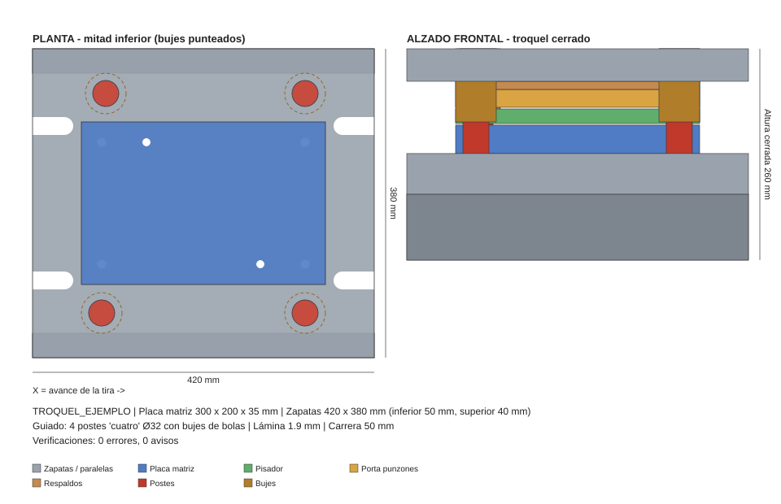

# troquel-nx · Diseño de troqueles con texto (Claude + Python + MCP + Siemens NX)

Usted describe el troquel con palabras y el sistema genera **toda la carcasa** (die set) en Siemens NX:
zapatas, paralelas, placa matriz, respaldos, pisador, porta punzones, **postes guía y bujes**, espiga,
barrenos de tornillería y pasadores y ranuras de sujeción. Además entrega la lista de materiales y las
verificaciones de ingeniería.

```
"Troquel progresivo de 300x200 para lámina calibre 14, 4 postes de 32 con bujes de bolas,
 altura cerrada 260, carrera 50, prensa de 60 toneladas"
```



## Cómo funciona

```
 Usted (texto) ──► Claude ──MCP──► servidor troquel-nx (Python)
                                     │  1. interpreta / valida los datos   (spec.py, text_parser.py)
                                     │  2. calcula la carcasa completa     (design.py, catalog.py)
                                     │  3. verifica guiado, prensa, choques (design.py, interference.py)
                                     │  4. genera journal NX Open + SVG + lista de materiales
                                     ▼
                          journal *.py  ──►  Siemens NX  (Alt+F8, o run_journal por lotes)  ──►  *.prt
```

* **Claude + MCP**: Claude conversa con usted, llama a las herramientas del servidor MCP y le muestra el
  resultado. Puede iterar: "ahora con postes de 40", "quítale las paralelas", "altura cerrada 300".
* **Python**: el motor de diseño es independiente de NX; también funciona desde la línea de comandos.
* **Siemens NX**: el journal NX Open (Python) crea una pieza nueva con un cuerpo por componente,
  con nombre, capa, color y atributos `MATERIAL`, `DESCRIPCION` y `MEDIDAS`.

## Instalación (Windows)

1. Python 3.10 o superior.
2. En una terminal:
   ```bat
   cd C:\troquel-nx
   python -m venv .venv
   .venv\Scripts\activate
   pip install -e .
   ```
3. Pruebe sin NX:
   ```bat
   python -m troquel "troquel de 300x200, lamina 1.5 mm, 4 postes"
   ```

### Conectar con Claude Desktop

Edite `%APPDATA%\Claude\claude_desktop_config.json` (hay un modelo en
[`config/claude_desktop_config.example.json`](config/claude_desktop_config.example.json)):

```json
{
  "mcpServers": {
    "troquel-nx": {
      "command": "C:\\troquel-nx\\.venv\\Scripts\\python.exe",
      "args": ["-m", "troquel.mcp_server"],
      "env": {
        "TROQUEL_OUTPUT_DIR": "C:\\troqueles",
        "UGII_BASE_DIR": "C:\\Program Files\\Siemens\\NX2306"
      }
    }
  }
}
```

Reinicie Claude Desktop. Verá las herramientas de **troquel-nx**.

### Conectar con Claude Code

```bat
claude mcp add troquel-nx --env TROQUEL_OUTPUT_DIR=C:\troqueles --env UGII_BASE_DIR="C:\Program Files\Siemens\NX2306" -- C:\troquel-nx\.venv\Scripts\python.exe -m troquel.mcp_server
```

### Variables de entorno

| Variable | Uso |
|---|---|
| `TROQUEL_OUTPUT_DIR` | Carpeta donde se guardan los diseños (por omisión `~/troqueles_nx`). |
| `UGII_BASE_DIR` | Instalación de NX; se usa `NXBIN\run_journal.exe` para construir por lotes. |
| `NX_RUN_JOURNAL` | Ruta directa a `run_journal.exe` (si no usa `UGII_BASE_DIR`). |

## Uso con Claude (sólo texto)

Ejemplos de lo que puede escribir:

* *"Diséñame un troquel progresivo de 450x220 para inoxidable de 1.2 mm, cuatro postes con bujes de bolas,
  altura cerrada 280 y carrera 60. Perímetro de corte 900 mm, prensa de 110 t."*
* *"Troquel de corte 200x150, dos postes traseros de 25, sin paralelas, con espiga de 40."*
* *"Al diseño TROQUEL_001 cámbiale los postes a 40 y la placa matriz a 45 mm."*
* *"Constrúyelo en NX."*

Herramientas MCP:

| Herramienta | Qué hace |
|---|---|
| `disenar_troquel` | Diseña con parámetros estructurados (Claude los extrae de su mensaje). |
| `disenar_troquel_desde_texto` | Diseña directamente desde una frase en español. |
| `modificar_troquel` | Cambia un diseño guardado con texto (`"postes de 40, sin paralelas"`) o con un dict. |
| `obtener_diseno` | Parámetros calculados, niveles Z, postes, verificaciones y geometría. |
| `listar_disenos` | Diseños guardados. |
| `catalogo_guias` | Catálogo de postes y bujes y parámetros disponibles. |
| `ejecutar_en_nx` | Construye el `.prt` en NX con `run_journal` (por lotes, sin abrir la interfaz). |

Cada diseño se guarda en `TROQUEL_OUTPUT_DIR\<NOMBRE>\`:

| Archivo | Contenido |
|---|---|
| `<NOMBRE>_journal_nx.py` | Journal NX Open que construye la carcasa. |
| `<NOMBRE>_vista.svg` | Planta y alzado para revisar sin NX. |
| `<NOMBRE>_lista_materiales.csv` | Lista de materiales (abre en Excel). |
| `spec.json` | Datos de entrada (permiten regenerar o modificar el diseño). |
| `diseno.json` | Diseño completo: parámetros, niveles, postes, primitivas, verificaciones. |

## Línea de comandos

```bat
python -m troquel "troquel de 300x200, calibre 14, 4 postes de 32, bujes de bolas, altura cerrada 260"
python -m troquel --modificar TROQUEL_001 "postes de 40, sin paralelas"
python -m troquel --spec mi_troquel.json --out C:\troqueles --nx
python -m troquel --catalogo
```

`--nx` ejecuta el journal en NX al terminar y `--json` imprime el resultado completo.

## Construir en NX

* **Interactivo**: en NX abra *Herramientas → Journal → Reproducir* (Alt+F8) y elija
  `<NOMBRE>_journal_nx.py`. Se crea `<NOMBRE>.prt` en la misma carpeta (si ya existe, `<NOMBRE>_v2.prt`).
* **Por lotes**: `run_journal.exe <NOMBRE>_journal_nx.py -args C:\ruta\<NOMBRE>.prt`, o la herramienta
  `ejecutar_en_nx` / la opción `--nx`.

Capas y colores en NX (editables en `troquel/catalog.py`):

| Capa | Componentes |
|---|---|
| 10 | Zapatas inferior y superior |
| 20 | Placa matriz |
| 21 | Respaldos (matriz y punzones / sufridera) |
| 22 | Pisador |
| 23 | Porta punzones |
| 30 | Postes guía |
| 31 | Bujes guía |
| 40 | Paralelas |
| 41 | Espiga |

## Qué calcula

Sistema de coordenadas: **X** = largo (avance de la tira), **Y** = ancho (+Y = atrás), **Z** = vertical;
origen en el centro de la placa matriz y en la base del troquel. El troquel se modela **cerrado**.

| Elemento | Regla automática (se puede forzar cualquier valor) |
|---|---|
| Placa matriz | `max(15 + 4·t + 0.04·D, ∛(0.1·F))` mm, mínimo 20, redondeado a espesor comercial. D = dimensión mayor, F = fuerza de corte en N |
| Fuerza de corte | `F = perímetro × t × τ` (τ por material: acero 300 MPa, inox 450, aluminio 150...) |
| Porta punzones / sufridera / pisador | 0.6 / 0.25 / 0.5 × placa matriz (mínimos 15 / 8 / 12 mm) |
| Zapata inferior / superior | `max(40, 1.25·Hm, 1.5·d)` / `max(35, 1.1·Hm, 1.2·d)` (Hm = placa matriz, d = poste) |
| Diámetro de poste | Por tamaño: ≤160 → Ø20, ≤250 → Ø25, ≤400 → Ø32, ≤630 → Ø40, ≤1000 → Ø50, mayor → Ø63; un paso más si t > 3 mm |
| Bujes | Diámetro exterior y largo de catálogo (fricción o bolas), a presión en la zapata superior |
| Posición de postes | Fuera de las placas (10 mm de claro al buje). `cuatro`/`trasero`/`diagonal`: adelante y atrás (no estorban la tira); `centro`: a izquierda y derecha |
| Poka-yoke | Un poste desfasado 5 mm (o, en diagonal, de diámetro distinto) para que la parte superior no se monte girada |
| Zapatas | Abarcan postes + pared (`max(20, 0.6·Øbuje)`) y `margen_sujecion` en X para bridas; ranuras en U en los extremos |
| Altura cerrada | Si se pide, se ajusta la altura de las paralelas (o se engruesa la zapata inferior si no hay paralelas) |
| Tornillería | M8/M10/M12/M16 según tamaño, 4 a 8 por placa, cajas para cabeza, machuelos, 2 pasadores por lado, largos estándar |

Verificaciones incluidas:

* **Guiado**: los postes deben entrar en los bujes antes de que el pisador toque la lámina
  (mínimo `max(10, 0.5·d)` mm). Con bujes de bolas el poste nunca debe salir del buje en toda la carrera.
* **Prensa**: fuerza de corte frente al tonelaje (aviso arriba del 80 %, error arriba del 100 %).
* **Bujes**: no deben chocar con la zapata inferior con el troquel cerrado (se recortan con aviso).
* **Interferencias** entre todos los cuerpos (por muestreo).
* Paralelas que tapen la caída de pedacería, tira demasiado ancha, postes al centro con avance de tira.

> Las reglas son prácticas de taller para un primer diseño. Revise el resultado con su criterio y los
> catálogos de su proveedor (Misumi, Danly, Fibro, Agathon...). Las tablas están en `troquel/catalog.py`.

## Personalizar

* **Catálogo de postes y bujes, tornillos, materiales, capas y colores**: `troquel/catalog.py`.
* **Reglas de dimensionamiento**: `troquel/design.py` (`build_design`).
* **Construcción en NX** (operaciones NX Open): `troquel/nx_builder_template.py`.

## Pruebas

```bat
pip install -e .[dev]
pytest
```

Las pruebas cubren las reglas de diseño (24 configuraciones sin interferencias), el intérprete de texto,
la CLI, el servidor MCP y el journal. Este último se ejecuta contra un **NXOpen simulado**, que comprueba
la secuencia de llamadas pero no la API real de NX: la primera vez córralo en su versión de NX y
revise la ventana de información, que lista cada componente creado y cualquier aviso.

## Limitaciones y siguientes pasos

* Genera la **carcasa**, no los elementos de corte: punzones, aberturas de la matriz, resortes y tornillos
  de pisador quedan para el diseñador (o para una siguiente versión).
* Produce una pieza multicuerpo (un cuerpo por componente). Para un ensamble use *Crear componente* o
  *WAVE* en NX.
* Unidades en milímetros.
